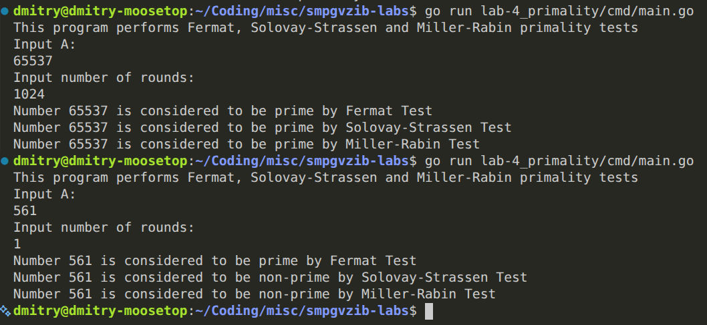

# Лабораторная работа №4
## Вероятностные тесты на простоту

Требуестся `Go` версии `1.24.3` и выше.

Проект реализует алгоритмы проверки на простоту Ферма, Соловея-Штрассена и Миллера-Рабина

Точка входа для запуска программы располагается в `/cmd`:
```bash
go run lab-4_primality/cmd/main.go
```

### Пример запуска
